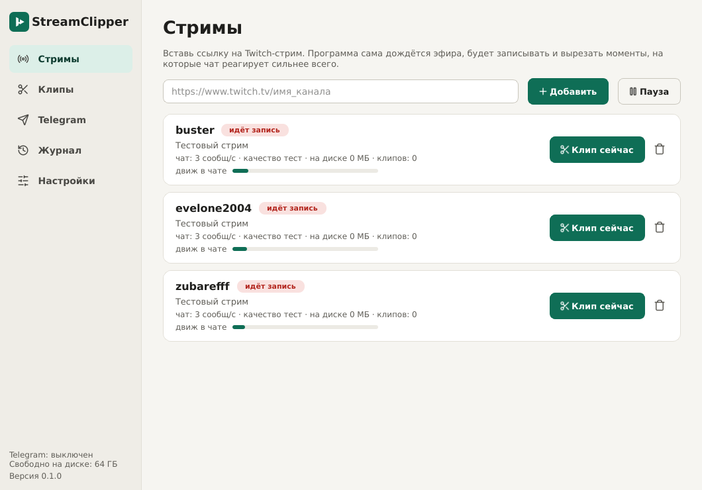
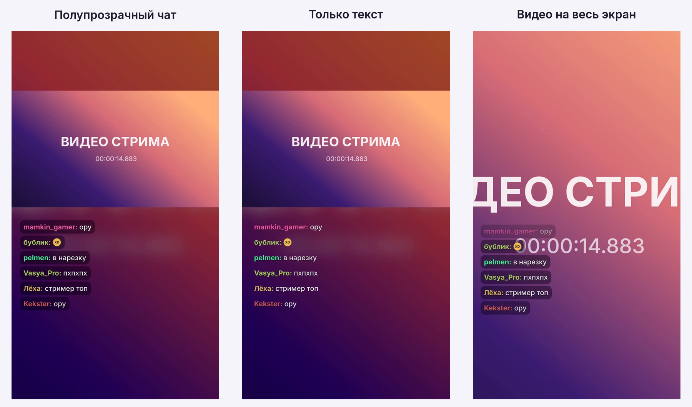
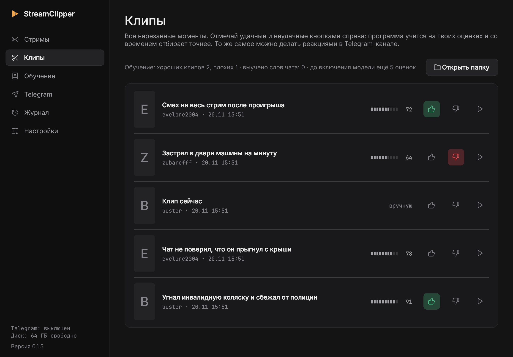

# StreamClipper

Программа для Windows, которая сама смотрит Twitch-стримы и вырезает из них смешные моменты.
Вставил ссылку на стрим, и дальше всё происходит без тебя: запись, поиск момента, нарезка,
описание, отправка в Telegram-канал.

**[Скачать StreamClipper-Setup.exe](https://github.com/Satoros1/streamretranslator/releases/latest/download/StreamClipper-Setup.exe)**



## Как начать

1. Скачай и запусти `StreamClipper-Setup.exe`. Windows может показать синее окно «Система защитила ваш компьютер»:
   нажми «Подробнее», потом «Выполнить в любом случае». Так бывает со всеми программами без платной подписи.
2. На вкладке **Стримы** вставь ссылку вида `https://www.twitch.tv/имя_канала` и нажми «Добавить».
   Можно добавить несколько стримов, по умолчанию до шести одновременно.
3. Всё. Клипы появятся на вкладке **Клипы** и в папке `Видео\StreamClipper`.

Стример может быть не в эфире: программа дождётся начала сама.

## Как она понимает, что было смешно

Программа читает чат стрима и знает, как смеётся русский чат: «ахахах», «ору», «пхпхпх», «кек», «ржу»,
KEKW, LUL, OMEGALUL, эмоуты каналов, капс, «в нарезку» и так далее.

У каждого канала своя норма: где-то 5 сообщений в секунду, где-то 50. Программа постоянно меряет норму
именно этого чата и ловит резкий всплеск смеха относительно неё. Спам командами вроде `!drop` всплеском не считается.

Дальше она **ждёт, пока движ закончится**, и вырезает один непрерывный кусок без склеек: подводка, сам момент,
реакция. Обычно это 30–60 секунд. Если чат взрывался несколько раз подряд по одному поводу, получится один клип, а не три.
Резать старается в паузах речи, а не на полуслове.

Всё это работает на твоём компьютере и не тратит токены.

## Почему запись почти не занимает места

Стрим пишется «по кругу»: на диске лежат только последние 6 минут, всё старое стирается само.
Это примерно 350 МБ на один стрим в лучшем качестве, сколько бы часов он ни шёл.
Навсегда сохраняются только клипы. У папки клипов тоже есть лимит (по умолчанию 30 ГБ).

## Клипы сразу под TikTok

По умолчанию клип получается вертикальным: **1080×1920, H.264 + AAC**, столько же кадров в секунду, сколько на стриме.
Его можно сразу выкладывать в TikTok, Shorts и Reels. В настройках выбирается вид кадра:

- **Стрим целиком, фон размыт.** Видео видно полностью, сверху и снизу мягкий размытый фон, чат под видео.
- **На весь экран.** Крупнее, но края по бокам обрезаются. Чат полупрозрачно поверх, слева внизу.

Низ кадра и правый край оставлены свободными: там в TikTok подпись и кнопки.

Можно выбрать «Как на стриме, 16:9»: тогда клип вырезается из записи как есть, без перекодирования и потери качества.
Или «Оба файла».



## Чат стрима в клипе

Программа записывает чат вместе с видео и рисует его в вертикальном клипе: сообщения появляются тогда же,
когда появлялись в эфире. Ники в своих цветах, смайлы Twitch, 7TV, BetterTTV и FrankerFaceZ картинками.

Чат полупрозрачный и не лезет на видео. Чат большого канала летит быстрее, чем можно прочитать, поэтому
показывается не каждое сообщение: чем сильнее движ, тем быстрее лента, но так, чтобы её успевали читать.
Сообщения, которые удалили модераторы, сообщения ботов, команды и ссылки в клип не попадают.
В настройках можно задать свои запретные слова, поменять размер и вид чата или выключить его.

Весь чат за время клипа ещё и сохраняется текстом в файле с описанием рядом с клипом.

## Telegram

Клипы уходят в канал **файлом**, а не «видео», поэтому Telegram их не пережимает. Лимит на файл 2 ГБ.

Настройка на вкладке **Telegram**, один раз:

1. Получи `api_id` и `api_hash` на [my.telegram.org](https://my.telegram.org/apps) (бесплатно, 2 минуты).
2. Войди своим аккаунтом (номер, потом код из Telegram) или укажи токен бота.
3. Нажми «Мои каналы» и выбери канал.

Если интернет пропал или программу закрыли, клипы не теряются: очередь хранится на диске и досылается потом.

## Программа учится на твоих оценках

Ставь клипам 👍 и 👎 на вкладке **Клипы** или реакциями прямо в Telegram-канале (удалённый из канала пост
считается как 👎). На этих оценках программа учится трём вещам:

- **Оценка.** Небольшая модель подстраивает оценку «смешности» под твой вкус. Включается после 8 оценок.
- **Чувствительность по каналам.** Много 👎 на канале: порог срабатывания растёт. Нажимаешь «Клип сейчас»
  (значит, момент был пропущен): порог падает.
- **Словарь канала.** Локальные мемы и эмоуты, которыми именно этот чат реагирует на удачные моменты,
  начинают считаться реакцией. Слова из плохих клипов (спам, боты) перестают учитываться.

Если чат очень живой и моменты идут один за другим, программа не делает клип на каждый: первый за 10 минут
проходит всегда, а каждому следующему нужна всё более высокая оценка. Так с одного канала выходит несколько
лучших клипов, а не клип каждую минуту. Хочешь больше клипов: подними **Чувствительность** в настройках.



## Описание клипа

К каждому клипу пишется короткое описание: что говорил стример, чем отвечал чат, оценка, время.

- **Распознавание речи** (Whisper) работает на компьютере, бесплатно. Первый раз скачает модель, около 500 МБ.
- **ИИ-описание** (необязательно): если вписать ключ Anthropic API, Claude напишет заголовок и описание
  и уточнит границы клипа. Это один короткий запрос на клип, только на уже отобранные моменты.

## Реклама Twitch

Рекламные вставки вырезаются из записи автоматически, а клип никогда не режется «через рекламу».
Если у твоего аккаунта Twitch есть Turbo или подписка на канал, можно вписать токен в настройках, и рекламных пауз не будет совсем.

## Чтобы работало само и не падало

- Каждый стрим пишется в отдельном процессе. Завис или упал один: остальные продолжают, а этот перезапускается.
- Запуск вместе с Windows, список стримов восстанавливается.
- Компьютер не уходит в сон, пока программа работает.
- Следит за диском, процессором и памятью, предупреждает в Telegram: стрим закончился, мало места, ошибки, итоги дня.
- Модуль записи Twitch обновляется сам, если Twitch что-то поменял.
- Закрытие окна сворачивает программу в значок возле часов. Выход: правой кнопкой по значку.

## Важно про авторские права

Стримы принадлежат стримерам. Перед тем как публиковать нарезки, договорись со стримером или убедись, что он не против.

## Для разработки

```
pip install -r requirements-dev.txt
python -m streamclipper            # окно
python -m pytest -q                # тесты
```

Нужен `ffmpeg` в PATH. Сборка установщика идёт в GitHub Actions (`.github/workflows/build.yml`),
релиз появляется после пуша тега `v*`.
